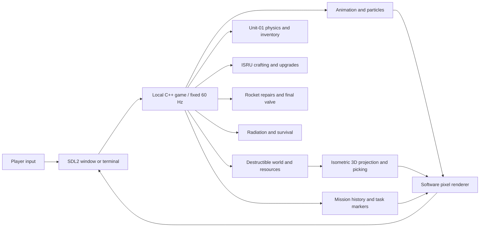

# Unit-01: local architecture

The supplied flow reference guides the story and the core systems. The implementation remains C++17 with a local SDL2 or terminal frontend. All runtime state is in memory; there is no database, backend process, network service, cloud storage, telemetry, leaderboard or login dependency.

World tiles, item stacks, upgrades, completed gathering/crafting counts, core recovery and rocket milestones are owned by the running `Game`. A restart clears this state. Exported GIFs, PNGs and PPMs are local preview artifacts; they do not save player progress.

## Story progression

| Reference stage | Current prototype behavior |
| --- | --- |
| Prologue | Unit-01's opening mission message and field manual introduce the goal and controls; a cinematic tutorial is not implemented |
| Act I — Discovery | Mine resources, forge plates, refine propellant, recover the data core and optionally upgrade parts |
| Act II — Repair | Weld the hull, connect fuel lines, socket the core and calibrate launch control |
| Act III — Sacrifice | Traverse the raised gantry ramp under SPE exposure and manually activate the valve |
| Game End | Rocket departure, permanent Unit-01 shutdown, black fade and a thank-you message |

Six checklist tasks provide persistent-within-session completion marks. Markers point to the current resource, base bench, core, rocket socket or summit valve as appropriate. Collecting and crafting history is separate from current inventory, so spending materials cannot undo a completed objective.

The default gameplay view contains health, a short objective cue, a compact current-task card, six small progress icons and a material hotbar. Hovered material names appear only in the fixed bottom inspection strip, including inventory and recipe items. The expanded checklist (`T`), visual crafting cards (`C` near the bench), full inventory (`Tab`) and controls guide (`H`) are opened on demand. Craft card affordability is checked against actual inventory and bench proximity, and clicking a card invokes the same `Game::perform()` transaction as keyboard crafting. All material icons are native C++ pixel drawings; no asset downloads or services are needed.

`TargetTool` selects mining or placement on J key-down and routes actions through the existing authoritative game methods. Holding J after mining completes cannot automatically place into the newly empty cell. Releasing the key, losing focus or opening a menu releases the mining latch.

`SpaceBackground` renders a lit, rotating textured sphere and depth-sorted rotating asteroid meshes using CPU projection and triangle rasterization. Faceted mountain layers scroll at different fractions of camera movement; caves retain a shaded back wall. Its rendering is clipped to the gameplay viewport and is deterministic for a given clock/camera. It owns no gameplay state and makes no network requests.

The presentation subsystem is separate from authoritative gameplay. Particle limits and lifetimes bound its memory usage; its private deterministic sequence does not change world generation. Renderer calls do not advance the simulation. Preview capture drives the same input/action paths as ordinary gameplay.

## Isometric gameplay

The ship interior uses the same orthographic ground basis, full-size robot meshes, screen-relative movement, jump physics and HUD as Map1. Its 32 x 57 floor plan is half the previous width and keeps compact fixtures inside a connected deck. `IsometricScene` keeps a separate following camera for the deck and depth-sorts furniture and cutaway walls. Furniture retains visible support heights, while hull cells use an unclimbable collision height so the robot cannot cross or land on walls. The deck minimap shows room and station positions. See [ship gameplay and preview generation](SHIP_INTERIOR.md).

The default `WorldGrid::generate_isometric()` produces a seeded 144×64 overhead island with a separate elevation field and optional solid resource nodes. World y means map south; regolith does not fall along that axis. `Unit7Entity` normalizes planar input, resolves ground-plane collisions, resolves obstacle volumes and supports a gravity-driven vertical jump. Camera-relative WASD is converted into world-plane vectors.

`IsometricScene` projects 3D floor/resource/building faces orthographically, sorts objects by ground depth and paints a per-pixel cell-ID buffer. Mouse/J picking reads the visible face IDs, avoiding the incorrect flat-ground inverse projection on raised ore. Elevated floor surfaces, ramp steps and solid machinery participate in movement constraints. The original side-view physics is selected only by explicitly constructing its world.

Vertical motion is independent of map x/y. The robot stores absolute foot elevation, current support elevation and vertical velocity. Each 1/120-second physics substep integrates constant acceleration exactly. Grounded walking can step a short stair; airborne movement must clear a surface or obstacle top physically. Descending feet clamp to the highest supporting surface, enabling landing on low blocks and falling after support removal. Jump input is consumed immediately and never queues a midair bounce. Rendering projects the actual height, keeps the shadow on support and drives takeoff/landing poses from grounded transitions.

`IsometricDemo` uses bounded breadth-first navigation and ordinary movement/mining/actions to verify the full mission on the same map used by the window. Planar storm sampling treats map rows as horizontal positions, so northern rocks cannot incorrectly count as overhead shielding.

## Rescue aircraft and navigation

`BaseCamp` defines the rescue aircraft cabin at x4..11, y3..8. World generation flattens its landing area, stamps unmineable hull/furniture cells, and leaves a two-cell opening for the rear ramp. Ordinary movement enters and exits the aircraft; no teleport or separate scene is involved. Placement within its footprint is rejected so the green entrance and cabin remain usable. `Game::inside_base()` derives interior state from the actual robot location.

`IsometricScene` draws one complete rescue aircraft instead of the former base and scattered wreck. A tapered pale fuselage, swept wings, navy canopy, magenta bands and one tall plus two short tail fins form the exterior. The lower hull sorts behind cabin objects; the upper shell sorts in front and changes to a clean rail cutaway when the robot approaches or enters. The open rear ramp has a permanent emissive green silhouette. Interior fixtures, the astronaut and charger retain independent depth sorting, collision and interaction behavior.

The planar mission constructs its sole `NASA_ISRU_Refinery` at `BaseCamp::craft_bench` and marks it `indoor_only`; there is no duplicate exterior bench. `can_operate(unit)` requires both real shelter occupancy and normal bench range, preventing interaction through the low visual boundary. UI availability, task markers, audio ambience and transactions share this same station position, and recipe costs remain unchanged. The refinery type retains optional secondary-bench support for non-mission configurations; side-view games keep their original unrestricted station behavior.

`Minimap` renders a north-up, aspect-preserving terrain field in the lower-left corner. Its compact robot-head, house and rocket symbols use live world positions. Nearby symbols separate with a leader line and exact location dot. The panel sits below the danger alert, above inventory, and consumes world mouse input. It owns no simulation state and never changes picking IDs.

The larger map reuses cached terrain vertex colors keyed by dimensions and seed; block mining does not alter the immutable elevation/material fields. Off-screen terrain cells are culled early, and the orthographic backdrop avoids shading material that visible terrain immediately covers.

## Planet terrain, robot pose and lights

`PlanetTerrain` supplies deterministic smooth noise, crater bowls/rims and matching material variation. Hub routes remain graded, and the launch ramp remains authored. Rendering joins neighboring terrain vertices to avoid gaps between cells, while height-aware movement and gravity continue to use the world support field. Resource meshes vary by seeded position; border obstacles render as a rocky ridge.

`Presentation` stores smoothed chassis/head angles, left/right tread phase and damped acceleration/turn lean. Rendering consumes this state without advancing time. Mining targets drive the head servo; the chassis follows actual velocity with a quick exponential turn response and limited suspension lean. Ground movement approaches desired velocity using bounded vector acceleration, preserving diagonal speed. Ground braking is 85 world units/s²; reversals use 60 and forward acceleration uses 36. Air control remains 18. Ground contact follows descending steps up to 0.22 units; larger drops retain ballistic gravity.

`RobotAppearance` belongs to `PixelRenderer`, separate from `Game`. Mark 1 retains the original robot mesh and palette; Mark 2 has its own procedural mesh and editable armor/trim/optics materials. Both consume the same animation pose and gameplay footprint. `RobotEyes` shares each model’s lens positions and pitched head transform between the mesh and lighting, including terrain interpolation, jump elevation, idle motion and head suspension. K or the top-left model badge changes the selected mesh without changing simulation state. Restarting a mission keeps renderer selection. Archived side-view rendering retains its original robot.

Tread impressions are sampled every 0.14 units of actual grounded displacement, independent of render or simulation frame rate. Each world-space stamp describes both tracks using the chassis heading. Airborne transitions break the trace, so landing never connects across a jump. A deque retains at most 4,096 stamps for 30 seconds. `Presentation::tread_opacity` holds full visibility for five seconds and applies a smoothstep fade over the remaining 25 seconds. `IsometricScene` alpha blends both tread bars and dust edges with the existing terrain pixels, avoiding an abrupt color replacement at expiry. Steep seams, occupied cells and the hidden hemisphere are excluded. Rendering does not mutate mark history or picking IDs.

`SceneLighting` runs before the HUD and never changes picking IDs. Two eye spotlights follow head orientation and pitch, jump height and independent head suspension. Each beam combines a Gaussian focused center with broader feathered spill, smooth range falloff and a cool-white/blue mix that preserves receiver material colors; intensity still follows eye aperture and glow. Terrain receivers use continuous surface height and grazing-angle attenuation. Three nearby visibility samples create a small penumbra at rock edges, and the lens mesh uses restrained local bloom. Beam work is restricted to the robot's local range. A damped pitch spring lifts the gaze on ascent, looks down during a fall and dips/rebounds on landing; the base, data core and mining impact provide local light pools. Directional/contact shadows are visual approximations. B toggles the eye beams without changing game state. All rendering is local and uses no external textures or service.

`SceneShadows` runs after terrain decals and before opaque objects. Analytic world-space casters produce sun-directed shadow volumes and tight contact patches; penumbra width increases with caster/receiver separation. Jump and launch height displace and soften shadows. A maximum-opacity mask combines overlapping casters without repeatedly darkening pixels, and cool ambient light keeps shaded surfaces readable. Receiver inverse projections are cached on a half-resolution mask, reconstructed bilinearly to keep soft edges while limiting CPU cost. Receiver bounds include the terrain elevation range, including the raised terrace. The shadow pass preserves the picking buffer and clips to the gameplay viewport.

The rocket renderer builds a shaded 20-facet circular hull with two tank stages, an ogive fairing, nozzle, fins, seams and service conduit. Platform and mast geometry use the ground elevation; only the vehicle and translucent exhaust follow launch lift. Repair markers sit beside the hull so the shape remains visible. Mesh and shadow changes do not alter rocket transactions, collision volumes or launch timing.

## Curved planet projection

`PlanetProjection` defaults to its existing spherical mapping when used directly. `IsometricScene` selects its orthographic expedition branch by default, with a fixed 22/11 pixel ground basis and 20 pixel height scale. This keeps factory dimensions constant across camera positions. Tight exponential following tracks position and ground height without velocity look-ahead, avoiding a camera lurch when stopping or reversing; jump height does not feed the camera. G switches projection branches and rebuilds the current picking buffer immediately.

The optional globe branch maps the local rotated grid into longitude/latitude on a sphere. Altitude extrudes radially, so the same jump height lifts the robot above its surface shadow. The camera eases the chart anchor toward the player; the sphere center/horizon stay fixed while terrain rolls beneath the robot. Logical movement, resource costs and gravity are unchanged.

The far hemisphere is culled, a lit far-field shell fills the planet limb, and space stays unpickable. Interactive geometry still paints cell IDs. Placement outlines use the exact projected floor corners; item inspection uses a point on the actual raised resource geometry. Scene lighting caches a local inverse Jacobian for each visible cell to keep light pools aligned without expensive per-pixel inverse trigonometry. Tests cover projection inversion, horizon curvature, far-side culling and cursor-driven mining on the curved surface.

## Sound effects

`Presentation` retains a bounded history of 32 serial-numbered sound events. Successful gameplay actions emit cues; rejected transactions emit an error cue. `SoundEffects` synthesizes short effects and smoothly faded machinery/laser/storm loops at 48 kHz, with a fixed 24-voice pool and bounded output. It has no SDL dependency and never changes gameplay or terrain randomness.

The SDL frontend starts in a renderer-owned menu state before advancing the simulation. `PixelRenderer` draws its animated star field through `SpaceBackground`, owns main/mission/options page navigation, and emits start commands for Missions 1 through 4 or Quit. Mission 1 supply delivery and observations start Mission 2: scanning the carrier robot, finding three replacement parts and repairing it. Its six-second repair starts Mission 3's Monitor Room PC task. Pressing E near that PC starts a four-second copy on the fixed simulation clock. Pausing freezes it; moving away cancels it; successful copying ends the campaign. The mission menu also offers direct test entries, including Missions 2 and 3 and a Mission 4 placeholder. The frontend creates a fresh campaign only after the start command, so menu time cannot advance daylight, danger, battery or mission state.

The SDL frontend consumes each event once and queues about 64 ms of stereo PCM on the main thread. No audio callback accesses game objects. U mutes audio, losing window focus or opening the guide clears the queue, and new missions reset synthesis and event cursors. Device initialization failure leaves the game playable. Offline rendering and terminal modes do not open an audio device.

## Expedition survival

`PhobosClock` advances a uniform mean-solar model at 60× simulation speed (a 459.44-second gameplay cycle). Dawn/dusk countdowns use gameplay seconds. Its period derives from the published Phobos rotation and Mars year, while the display uses normalized 24-hour local solar time. `SceneLighting` changes outdoor ambient light with solar altitude, preserves indoor electrical light, and keeps sky/background handling separate. Direct sun-shadow strength fades at night while contact occlusion remains. Renderer calls do not advance the clock.

`Unit7Entity` owns charge independently of integrity. It accounts for elapsed idle time, actual post-collision travel, successful takeoff, valid laser work and successful placement. `Game` prechecks heavier recipe/repair costs before transactions and debits only successful work. `alive()` requires positive charge and integrity; exhaustion halts actuators, and the climax transitions to Failed. Charge cannot revive an empty/offline unit.

`Game` automatically charges a grounded stationary unit within 0.65 world units of the indoor recharge point. `IsometricScene` surrounds it with a broken rear cabinet, unequal side pylons, split brace, exposed cable, snapped induction rail and animated transfer arcs. All charger checks still use actual world position; the box is visual, uses no teleport and introduces no new movement obstacle.

`DangerSystem` has its own seeded random stream, separate from terrain and particles. Calm → Warning → Active → Calm transitions emit countdown pulses and spawn bounded creature groups. A shared BFS flow field refreshes twice per second, and collision-safe pursuit follows walkable terrain. Creatures cannot enter the habitat/doorway, attack through walls or damage a sheltered robot. Melee damage feeds the unit's charge through `Game`, which emits hit sounds and attack feedback. Default missions choose a fresh hazard seed; tests/previews can supply a deterministic seed and short schedules without patching game state.

HUD countdowns and the red boundary are driven by the same phase and timer as spawning. A critical timer strip remains above modal menus. The dock, clock and warning panels consume world mouse input. Warning beeps, low-battery tones, charge confirmation and hit effects use the existing audio event stream. Field-guide pause and window focus loss freeze simulation, danger timers and the solar clock together; audio is also paused so a muted background warning cannot consume the return-home window.

Pause state belongs to `Game`; `set_paused` drops any pending fixed-step remainder and jump, and prevents actions and all simulation clocks from advancing. `PixelRenderer` owns the pause/settings pages and session sound preferences; SDL consumes explicit Restart/Quit menu commands. The audio mixer applies separate master, effects, machinery and chatter gains.

Physical impacts reduce integrity through `Unit7Entity::apply_damage`. Planar landing damage starts above 7.5 units/s; fast wall impacts have a cooldown and cannot repeatedly damage a robot pushing against the same wall. The HUD exposes integrity as an always-visible HP bar independent of battery. `Presentation` blends in the damaged gait strictly below 40% battery, adds integrity-based impairment, emits more frequent travel sparks, and on shutdown produces sparks/smoke before driving stronger body roll, head drop and suspension compression. The scene detaches an armor panel and cable during collapse; the HUD adds a structural-hit rim and flashes the HP bar. Failed missions keep world/mission clocks frozen while only the wreck settles and presentation completes the collapse.
